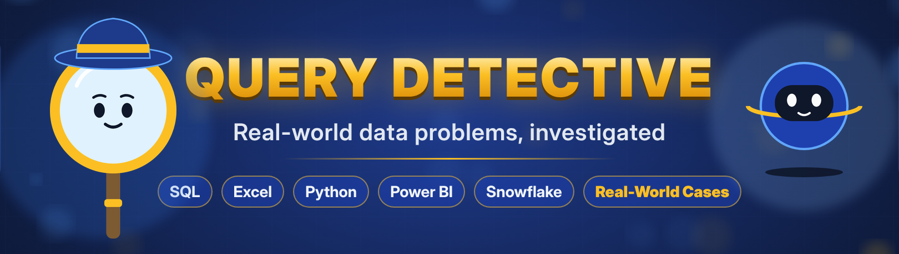

# Hi, I'm Query Detective 🔍

**Real-world data problems, investigated.**

Most tutorials teach features. Query Detective teaches *thinking*: how to look at messy, real data, find what's actually going on, and explain it clearly. Every case is solved step by step with **Detective Q** (the expert) and **Byte** (who asks the questions you're thinking).

### 🗂️ What you'll find here

| Topic | What you'll learn |
|---|---|
| 🗄️ **SQL** | real-world queries, hidden data traps, and schema puzzles |
| 📊 **Excel** | from a single cell to advanced analysis, taught properly |
| 🐍 **Python** | pandas and automation for working analysts |
| 📈 **Power BI** | turning data into decisions |
| ❄️ **Snowflake** | cloud data warehousing, explained |
| 🧩 **Full projects** | complete, end-to-end data analyst cases |

### 🧩 Featured project

**[Where Did the Profit Go?](https://github.com/querydetective/where-did-the-profit-go)**: a full data analyst portfolio project. Sales rose 19% while profit fell 18%. Python, SQL, an A/B test, and machine learning find out why.
▶️ [Watch the 2-hour walkthrough on YouTube](https://youtu.be/rla5Fe15tws)

### 🔗 Find me

📥 **Free SQL Traps cheat sheet** at [querydetective.com](https://querydetective.com)

---
*Made by Srini Voleti, a working data analyst who believes anyone can learn data when it's explained with patience.*
